

<picture><source media="(prefers-color-scheme: dark)" srcset="assets/hero-dark.svg"></picture>

<picture><source media="(prefers-color-scheme: dark)" srcset="assets/social-l-dark.svg"></picture><a href="https://t.me/WillowWilson78"><picture><source media="(prefers-color-scheme: dark)" srcset="assets/social-1-dark.svg"></picture></a><a href="mailto:hertacute78@gmail.com"><picture><source media="(prefers-color-scheme: dark)" srcset="assets/social-2-dark.svg"></picture></a><a href="https://www.facebook.com/WillowWilson78#"><picture><source media="(prefers-color-scheme: dark)" srcset="assets/social-3-dark.svg"></picture></a><picture><source media="(prefers-color-scheme: dark)" srcset="assets/social-r-dark.svg"></picture>

<picture><source media="(prefers-color-scheme: dark)" srcset="assets/about-dark.svg"></picture>

<picture><source media="(prefers-color-scheme: dark)" srcset="assets/stack-dark.svg"></picture>

<a href="https://github.com/Willowwilson78-hub/ESP32-CYD-Photoframe"><picture><source media="(prefers-color-scheme: dark)" srcset="assets/project-esp32-cyd-photoframe-dark.svg"></picture></a>&nbsp;<a href="https://github.com/Willowwilson78-hub/REDMI-Note10-JE-5G-Root-Tutorial"><picture><source media="(prefers-color-scheme: dark)" srcset="assets/project-redmi-note10-je-5g-root-tutorial-dark.svg"></picture></a>

<a href="https://github.com/Willowwilson78-hub/Anime-Hair-Palette-Calculator"><picture><source media="(prefers-color-scheme: dark)" srcset="assets/project-anime-hair-palette-calculator-dark.svg"></picture></a>&nbsp;<a href="https://github.com/Willowwilson78-hub/Newton-Cannon-Experiments"><picture><source media="(prefers-color-scheme: dark)" srcset="assets/project-newton-cannon-experiments-dark.svg"></picture></a>

<a href="https://github.com/Willowwilson78-hub/Wuwa-Config-For-Redmi-Note-14-5G"><picture><source media="(prefers-color-scheme: dark)" srcset="assets/project-wuwa-config-for-redmi-note-14-5g-dark.svg"></picture></a>

<picture><source media="(prefers-color-scheme: dark)" srcset="assets/stats-dark.svg"></picture>

<picture><source media="(prefers-color-scheme: dark)" srcset="assets/streak-dark.svg"></picture>

<picture><source media="(prefers-color-scheme: dark)" srcset="assets/wave-dark.svg"></picture>

<picture><source media="(prefers-color-scheme: dark)" srcset="assets/button-l-dark.svg"></picture><a href="https://metawka.github.io/expressive-profile/"><picture><source media="(prefers-color-scheme: dark)" srcset="assets/button-1-dark.svg"></picture></a><picture><source media="(prefers-color-scheme: dark)" srcset="assets/button-r-dark.svg"></picture>

<a href="https://metawka.github.io/expressive-profile/?from=Willowwilson78-hub"><picture><source media="(prefers-color-scheme: dark)" srcset="assets/credit-dark.svg"></picture></a>

