<picture><source media="(prefers-color-scheme: dark)" srcset="assets/hero-dark.svg"></picture>

<picture><source media="(prefers-color-scheme: dark)" srcset="assets/social-l-dark.svg"></picture><a href="https://t.me/"><picture><source media="(prefers-color-scheme: dark)" srcset="assets/social-1-dark.svg"></picture></a><a href="https://discord.com/"><picture><source media="(prefers-color-scheme: dark)" srcset="assets/social-2-dark.svg"></picture></a><a href="https://x.com/"><picture><source media="(prefers-color-scheme: dark)" srcset="assets/social-3-dark.svg"></picture></a><picture><source media="(prefers-color-scheme: dark)" srcset="assets/social-r-dark.svg"></picture>

<picture><source media="(prefers-color-scheme: dark)" srcset="assets/about-dark.svg"></picture>

<picture><source media="(prefers-color-scheme: dark)" srcset="assets/stack-dark.svg"></picture>

<a href="https://github.com/Willowwilson78-hub/REDMI-Note10-JE-5G-Root-Tutorial"><picture><source media="(prefers-color-scheme: dark)" srcset="assets/project-redmi-note10-je-5g-root-tutorial-dark.svg"></picture></a>&nbsp;<a href="https://github.com/Willowwilson78-hub/ESP32-CYD-Photoframe"><picture><source media="(prefers-color-scheme: dark)" srcset="assets/project-esp32-cyd-photoframe-dark.svg"></picture></a>

<a href="https://github.com/Willowwilson78-hub/Newton-Cannon-Experiments"><picture><source media="(prefers-color-scheme: dark)" srcset="assets/project-newton-cannon-experiments-dark.svg"></picture></a>&nbsp;<a href="https://github.com/Willowwilson78-hub/Blah-blah-blah"><picture><source media="(prefers-color-scheme: dark)" srcset="assets/project-blah-blah-blah-dark.svg"></picture></a>

<picture><source media="(prefers-color-scheme: dark)" srcset="assets/stats-dark.svg"></picture>

<picture><source media="(prefers-color-scheme: dark)" srcset="assets/streak-dark.svg"></picture>

<picture><source media="(prefers-color-scheme: dark)" srcset="assets/wave-dark.svg"></picture>

<a href="https://example.com"><picture><source media="(prefers-color-scheme: dark)" srcset="assets/button-1-dark.svg"></picture></a>&nbsp;&nbsp;<a href="https://github.com/Willowwilson78-hub?tab=repositories"><picture><source media="(prefers-color-scheme: dark)" srcset="assets/button-2-dark.svg"></picture></a>

<a href="https://metawka.github.io/expressive-profile/?from=Willowwilson78-hub"><picture><source media="(prefers-color-scheme: dark)" srcset="assets/credit-dark.svg"></picture></a>

